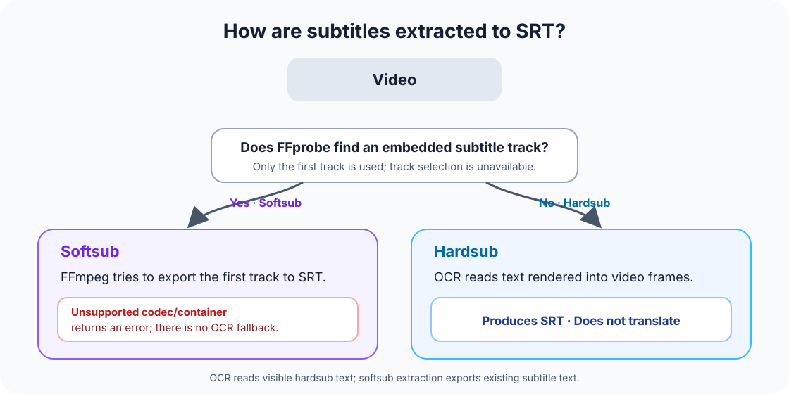

# hardsub2srt

Extracts burned-in hardsub subtitles into timed SRT files with local OCR. For embedded softsub tracks, FFprobe finds the stream and FFmpeg tries to export the first track. Unsupported codecs or containers cause an error; there is no OCR fallback. **OCR reads text; it does not translate.** Windows is the primary user platform, with Python as the runtime.

[Türkçe README](README.md) [TR] · **English README [EN]** · [Türkçe doküman haritası](docs/README.md) [TR] · [English documentation map](docs/README.en.md) [EN]

## Quick start

Python 3.10+ and FFmpeg/FFprobe on `PATH` are required on Windows. See [Installation and first run](docs/INSTALLATION-AND-FIRST-RUN.md) for setup instructions.

```powershell
py -3 hardsub2srt.py "D:\LOCAL-ONLY-PLACEHOLDER\input.mkv" -o "D:\LOCAL-ONLY-PLACEHOLDER\output.srt"
```

`-o` is required and names the target SRT file. Rerunning with the same target and same-name sidecars overwrites them. Use a new target name to preserve previous output. If the requested `.review-pack` folder already exists, the CLI stops instead of opening or overwriting it.

## Hardsub, softsub, and output

- **Hardsub:** the subtitle is rendered into video frames; OCR reads the visible text.
- **Softsub:** if FFprobe finds an embedded subtitle track, FFmpeg tries to convert the first track to SRT without OCR. An unsupported codec/container causes an FFmpeg error; there is no OCR fallback. The CLI cannot select a different track.



Hardsub OCR does not translate text or guarantee that it is correct. A hardsub CLI run may write run statistics and matching sidecars beside the SRT. These may include the video name, size/modified time, or a partial hash; review them before sharing.

Use `py -3 hardsub2srt.py --help` for CLI options. Common options:

- `--cpu` forces OCR to use the CPU.
- `--nvdec` tries FFmpeg's NVIDIA video-decoding path. This is separate from PyTorch CUDA for OCR; NVDEC is off by default and decoding falls back to the CPU if it fails.
- `--qa 0` disables QA montages. A full CLI run defaults to six samples; a run limited with `--limit-seconds` defaults to QA off.
- `--review-pack` creates a review pack for hardsub cues with a verified OCR-to-frame match. Direct softsub extraction does not create one.

The Windows batch launchers `cikar.bat` and `toplu.bat` accept multiple video files or folders. Both write SRT files beside the launcher, put four QA montages in a `qa/` folder beside it, and pass `--qa 4`. SRT names come from video basenames, so same-name videos can overwrite each other's output.

`toplu.bat` records successful files in the adjacent `kosuldu.list` by basename and file size, then skips matching entries on later runs. This does not verify file contents or hashes. `toplu.bat --yeni` disables skipping but keeps the list. See the [Usage guide](docs/USAGE-GUIDE.md) for details.

## Local web UI

Run `arayuz.bat` or `py -3 ui_server.py` to start the local Flask UI at `http://127.0.0.1:8765`. Each job writes to a new `runs/video-<name>/<timestamp>_<job-id>/` folder under the selected output root; previous run folders are not overwritten. The queue is in memory, so pending jobs are not restored after a server restart. The UI defaults to four QA samples and can disable them with 0.

OCR uses a CUDA-enabled PyTorch GPU when available, otherwise it falls back to CPU. The UI also offers a separate CPU option.

## Privacy and AI review

Video, OCR, and UI processing run locally; the application does not call GPT/DeepSeek APIs. Users may download selected review files as a ZIP and manually share them with an AI chat of their choice. An AI response is a proposal; human approval is required before accepting an OCR decision or translation-memory entry. Review packs contain SRT text and frame crops. If saved in a synced folder, tools such as OneDrive may sync them.

The optional `/katki` client is enabled only after an HTTPS endpoint, token, and retention period are configured. The user previews the payload and must separately approve the send. It may contain `duration_seconds`, `frames_scanned`, `cue_count`, `low_conf_count`, device/engine classes, `schema_version`, a UUID `submission_id`, and `created_at`. `speech_seconds` and `low_conf_ratio` are optional; `frames_scanned` is only a count. The UI does not send CER. Video files, images, SRT/VTT files, and subtitle text are excluded. The contribution API is still a prototype: it has not been deployed to a VDS, and no remote submission has been made. See [the optional contribution API](docs/CONTRIBUTION-API.en.md) [EN].

## Support and limitations

Windows is the primary user platform. CI runs automated tests on Windows and Ubuntu with Python 3.14; the Ubuntu CI result does not verify the full OCR/FFmpeg user workflow there. End-to-end macOS use has not been verified. GPU OCR depends on CUDA-enabled PyTorch and compatible drivers; NVDEC is a separate video-decoding option.

See [Contribution guidelines](CONTRIBUTING.en.md) [EN] for test-only changes and the [English documentation map](docs/README.en.md) [EN] for the complete English document list.

## License

MIT. Third-party libraries, models, and FFmpeg components have their own licensing and distribution terms; model weights are not included in this repository.
