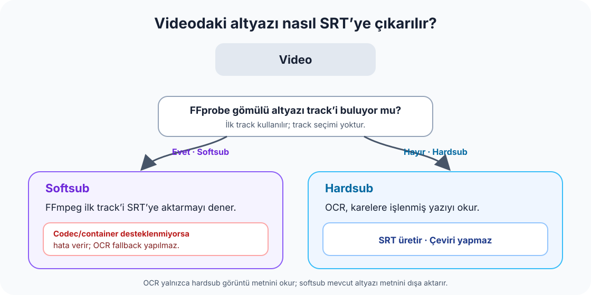

# hardsub2srt

Videoya işlenmiş hardsub altyazılarını yerel OCR ile zamanlı SRT’ye çıkarır; videodaki gömülü softsub track’lerini ise FFprobe ile bulup FFmpeg kullanarak ilk track üzerinden dışa aktarmayı dener. Desteklenmeyen codec/container hata verir; OCR fallback yapılmaz. **OCR metni okur, çeviri yapmaz.** Ana kullanım Windows ve Python’dır. [Türkçe doküman haritası](docs/README.md) [TR] · [English README](README.en.md) [EN] · [English documentation map](docs/README.en.md) [EN]

## Hızlı başlangıç

Windows’ta Python 3.10+ ve FFmpeg/ffprobe gerekir. Kurulum ve ilk çalıştırma adımları: [Kurulum ve ilk çalıştırma](docs/KURULUM-VE-ILK-CALISTIRMA.md).

Tek video:

```powershell
py -3 hardsub2srt.py "D:\LOCAL-ONLY-PLACEHOLDER\input.mkv" -o "D:\LOCAL-ONLY-PLACEHOLDER\output.srt"
```

`-o` zorunludur ve bir SRT dosya yoludur. CLI aynı `-o` hedefi ve aynı adlı yan dosyalarla yeniden çalıştırıldığında mevcut dosyaların üzerine yazar. Önceki çıktıyı korumak için yeni bir hedef adı seçin. İnceleme paketi de istenmişse mevcut `<ad>.review-pack` klasörü açılmaz veya üzerine yazılmaz.

## Hardsub, softsub ve çıktı

- **Hardsub:** Altyazı video karelerinin içine işlenmiştir; araç karelerden metni OCR ile okur.
- **Softsub:** FFprobe bir altyazı track bulursa araç OCR yapmadan FFmpeg ile ilk track’i SRT’ye dönüştürmeyi dener. Codec/container desteklenmiyorsa FFmpeg hata verir; OCR fallback yapılmaz. Mevcut CLI’de track seçme seçeneği yoktur.



Hardsub OCR çıktısını çevirmez veya metnin doğru olduğunu garanti etmez. Hardsub OCR koşumunda CLI, SRT’nin yanında aynı ada bağlı istatistik ve eşleşme yan dosyaları da yazar; bunlarda video adı, boyut/değişiklik zamanı ve kısmi hash bulunabilir. Paylaşmadan önce yan dosyaları inceleyin.

CLI ayarları için `py -3 hardsub2srt.py --help` kullanın. Temel seçenekler:

- `--cpu`: OCR’ı CPU’da zorlar.
- `--lang tr`: EasyOCR için altyazının dilini seçer. Varsayılan `tr`; İngilizce için `en`, gerçekten iki dilli altyazı için `tr,en` verin. İlgisiz dilleri eklemek tanımayı iyileştirmeyebilir.
- `--nvdec`: FFmpeg’in NVIDIA video decode desteğini dener. Bu, OCR’ı GPU’da çalıştıran PyTorch CUDA ayarından ayrıdır; NVDEC varsayılan olarak kapalıdır ve başarısız olursa decode CPU’ya düşer.
- `--qa 0`: QA kare montajını kapatır. Tam CLI koşusunda varsayılan 6 örnektir; `--limit-seconds` ile sınırlı koşuda varsayılan kapalıdır.
- `--review-pack`: özgün OCR segmentiyle güvenle eşleşen hardsub cue’ları için review pack üretir. Softsub doğrudan çıkarımda bu paket oluşturulmaz.

Windows batch launcher’ları `cikar.bat` ve `toplu.bat` birden fazla video dosyası veya klasör kabul eder. İkisi de SRT’leri launcher’ın yanına, dört QA montajını `qa/` klasörüne yazar ve `--qa 4` geçirir. Çıktı adı video basename’inden üretildiği için aynı basename’li videolar aynı SRT’ye çarpışıp önceki çıktıyı ezebilir.

`toplu.bat` başarılı işleri launcher yanındaki `kosuldu.list` dosyasına basename+dosya boyutuyla kaydeder; sonraki çalıştırmalarda bu eşleşmeye göre atlar. Bu kayıt içerik eşitliğini/hash’ini doğrulamaz. `toplu.bat --yeni` atlamayı kapatır; listeyi silmez. Ayrıntılı seçenekler ve çıktı davranışı: [Kullanım rehberi](docs/KULLANIM-REHBERI.md).

## Yerel web arayüzü

`arayuz.bat` çalıştırın veya `py -3 ui_server.py` komutunu verin; arayüz `http://127.0.0.1:8765` adresinde yalnızca bu bilgisayarda açılır. Arayüz işleri seçilen çıktı kökü altında her koşu için yeni `runs/video-<ad>/<zaman>_<iş-kimliği>/` klasörüne yazar; önceki koşu klasörlerini üzerine yazmaz. Kuyruk bellektedir ve sunucu yeniden başlatılınca bekleyen işler geri yüklenmez.

Arayüzün QA montajı varsayılanı 4 örnektir; 0 ile kapatılır. Dil alanı Türkçe altyazı için `tr` ile başlar. Review-pack arayüzde varsayılan olarak seçilidir; düşük güven, beklenmeyen alfabe, şüpheli token, çok kısa cue ve yüksek karakter/sn sinyalleri insan inceleme sayfasında uyarı olarak gösterilir. İkinci engine düşük güvenli cue’ları zaten yeniden okur. OCR için CUDA destekli PyTorch kullanılabiliyorsa GPU seçilir, aksi durumda CPU’ya düşer. `--cpu` arayüzde de seçilebilir.

## Gizlilik ve AI incelemesi

Video, OCR ve arayüz işlemleri yereldir; program GPT/DeepSeek API’sine bağlanmaz. Kullanıcı isterse inceleme dosyalarını ZIP olarak indirip seçtiği AI sohbetine elle gönderebilir. AI yanıtı öneridir; OCR kararı veya çeviri belleği kaydı olmadan önce normal insan onayı gerekir. Review pack SRT metni ve kare kırpımları içerir; eşitleme klasörüne kaydedilirse OneDrive gibi araçlar bu dosyaları ayrıca senkronize edebilir.

İsteğe bağlı `/katki` istemcisi yalnız HTTPS hedefi, token ve retention gün sayısı yapılandırıldığında açılır. Gönderimden önce kullanıcı önizlemeyi görür ve ayrıca onay verir. Payload `duration_seconds`, `frames_scanned`, `cue_count`, `low_conf_count`, `device_class`, `engine_class`, `schema_version`, UUID biçimindeki `submission_id` ve `created_at` alanlarını içerebilir. `speech_seconds` ile `low_conf_ratio` isteğe bağlıdır; `frames_scanned` yalnızca sayımdır. CER bu UI’de kapalıdır. Video, görüntü, SRT/VTT veya altyazı metni payload’a girmez. Katkı API’si prototiptir; VDS’ye dağıtılmamış ve uzak gönderim yapılmamıştır. Ayrıntılar: [İsteğe bağlı katkı API’si](docs/CONTRIBUTION-API.md).

## Destek ve sınırlar

Windows birincil kullanım platformudur. CI, Python 3.14 üzerinde Windows ve Ubuntu’da otomatik test çalıştırır; Ubuntu CI sonucu tam OCR/FFmpeg kullanıcı akışının desteklendiğini kanıtlamaz. macOS uçtan uca kullanımı bu repoda doğrulanmamıştır. OCR’ın GPU kullanması CUDA uyumlu PyTorch ve sürücülere bağlıdır; NVDEC ayrı bir video-decode seçeneğidir.

OCR veya kullanıcı verisi olmadan yapılan değişiklik testleri için [Katkı kuralları](CONTRIBUTING.md) ve tam belge listesi için [Doküman haritası](docs/README.md) sayfasına bakın.

MIT lisansı. Üçüncü taraf kütüphane, model ve FFmpeg bileşenleri kendi lisans/dağıtım koşullarına tabidir; model ağırlıkları bu depoda bulunmaz.
